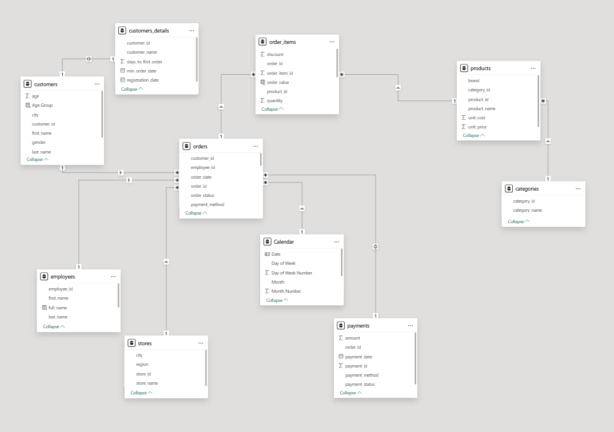
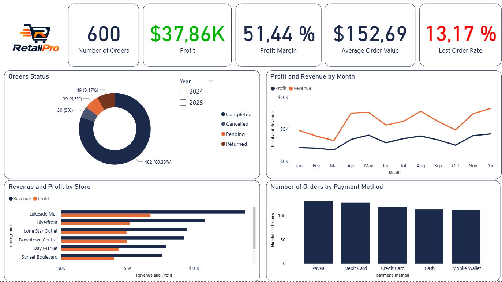
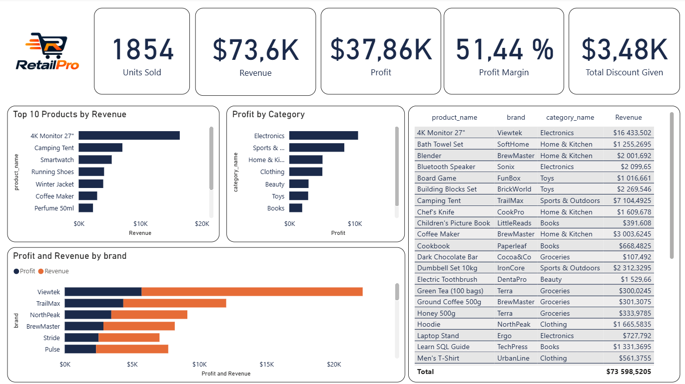
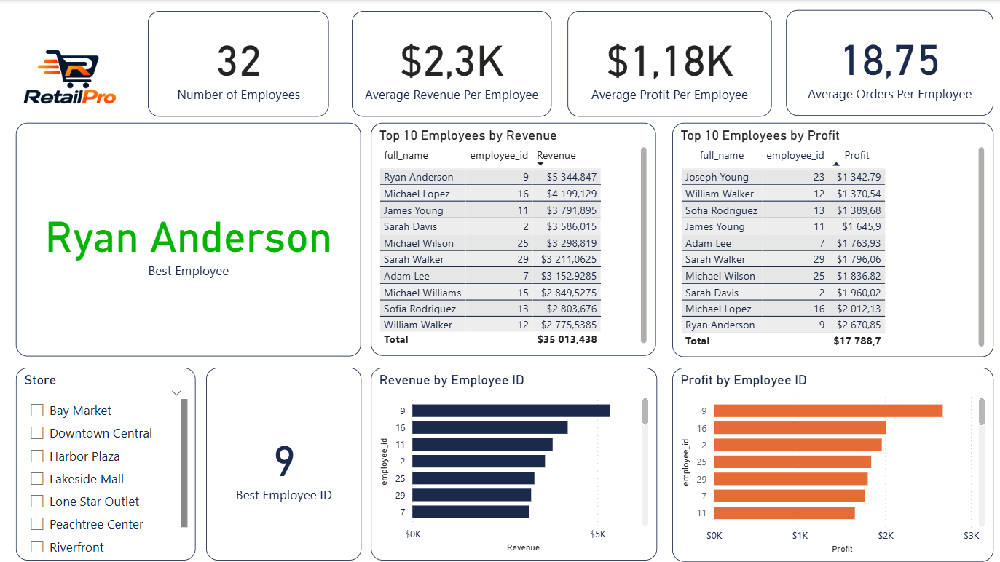
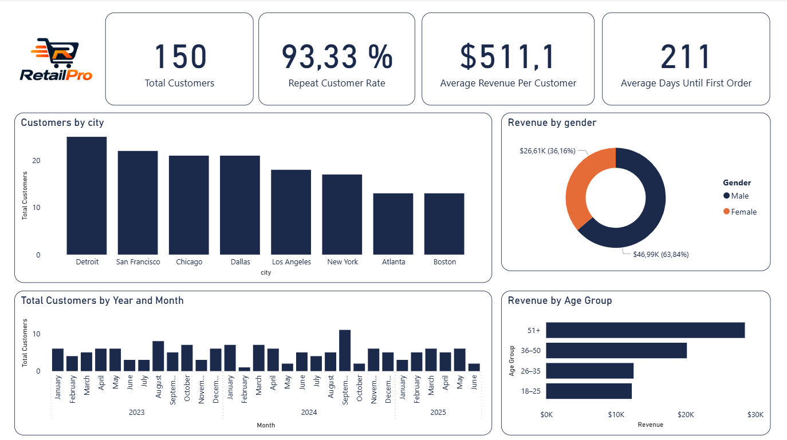

# Retail Sales Analysis

An end-to-end analysis of a retail store chain, from designing the database in **MySQL**, to answering business questions with **SQL**, to presenting the results in an interactive **Power BI** dashboard.

> **Note:** the data in this project is synthetic. It was generated for practice, so some patterns are more even than they would be in real data.

---

## Business Questions

- How much revenue and profit does the business make, and how is it trending?
- Which stores, regions and products drive the most profit?
- How much revenue is lost to cancelled and returned orders?
- Which employees perform best?
- Who are our customers, and how do they behave?

---

## Dataset

The database has **8 tables** covering the full sales process:

| Table | Description | Rows |
|---|---|---|
| `categories` | Product categories | 8 |
| `products` | Products, with cost and price | 38 |
| `stores` | Store locations and regions | 8 |
| `employees` | Store staff | 32 |
| `customers` | Customer profiles | 150 |
| `orders` | Orders, with status and payment method | 600 |
| `order_items` | Products within each order | 1,177 |
| `payments` | Payment transactions | 600 |

Orders cover **January 2024 to December 2025**.

### Data Model



---

## Tools

- **MySQL / MySQL Workbench**: database design, data loading and analysis
- **SQL**: joins, aggregations, subqueries, views, `ROLLUP`, date functions
- **Power BI**: data modeling, DAX measures and dashboard design

---

## Repository Structure

```
retail-sales-analysis/
├── README.md
├── retail_stores_dashboard.pbix     Power BI dashboard
├── images/                          Dashboard screenshots
└── sql/
    ├── create_tables.sql            Database and table creation
    ├── insert_data.sql              Sample data
    ├── analysis_sales.sql           Sales and store analysis
    ├── analysis_products.sql        Product and category analysis
    ├── analysis_employees.sql       Employee performance
    └── analysis_customers.sql       Customer analysis (includes a view)
```

---

## Key Findings

All figures are based on **completed orders** unless stated otherwise.

### Sales
- **73,598.52** in revenue and **37,858.52** in profit, a **51.4%** profit margin across **482** completed orders.
- Average order value is **152.69**.
- Revenue grew **87%** from 2024 to 2025.
- About **20%** of orders did not complete: 8.2% were returned, 6.5% are pending and 5.0% were cancelled. Cancelled and returned orders cost **10,024.86** in lost revenue, and returns account for almost twice as much as cancellations.

### Stores and Regions
- **Lakeside Mall** (Chicago) is the most profitable store, at **6,729.79**, about **1.8x** the least profitable, **Harbor Plaza** (Boston, 3,767.08).
- **Midwest** brings in the most profit but has the **lowest margin** (48.2%), while **West** has the least profit but the **highest margin** (53.6%).
- Lost-order rates range from **7%** (Peachtree Center, Lakeside Mall) to **16%** (Sunset Boulevard).

### Products
- **Electronics** is the largest category: **36%** of revenue, but with the **lowest margin** (39.3%).
- **Books** has the highest margin (**68.5%**), but little revenue.
- The **4K Monitor** is the top product by both revenue and profit.

### Employees
- The top employee, at Lakeside Mall, generated **5,344.85** in revenue, more than double the average per employee (2,300).
- Some employees have a lost-order rate (cancelled + returned) above **25%**.

### Customers
- **147 of 150** registered customers placed at least one order. On average, customers wait **211 days** between registering and their first order.
- Average revenue per customer is **511.10**.
- Female customers spend more per person (**543**) than male customers (**495**).
- **28 customers** have not ordered in the last 6 months of data, which makes them at risk of churning.

---

## Recommendations

1. **Reduce returns.** Returns cost more than cancellations. Investigate the most-returned products and the stores with the highest lost-order rates.
2. **Learn from Lakeside Mall.** Study what the top store does differently, and apply it to Harbor Plaza and the other lower-performing stores.
3. **Protect Electronics margins.** It's the biggest category but the least profitable per sale. Review pricing, supplier costs and discounts on high-value electronics.
4. **Speed up first purchases.** 211 days from registration to first order is slow. A welcome offer could convert new customers sooner.
5. **Win back inactive customers** with targeted promotions for the 28 customers who haven't ordered recently.
6. **Coach employees with high lost-order rates**, using the top performers' practices.

---

## Dashboard

The Power BI report has **4 pages**.

### Orders Overview


### Products


### Employees


### Customers


---

## How to Run

1. Run `sql/create_tables.sql` in MySQL to create the `retail_store` database.
2. Run `sql/insert_data.sql` to load the data.
3. Run any of the `analysis_*.sql` files.
4. Open `retail_stores_dashboard.pbix` in Power BI Desktop. If needed, update the MySQL connection under **Transform data → Data source settings**.
